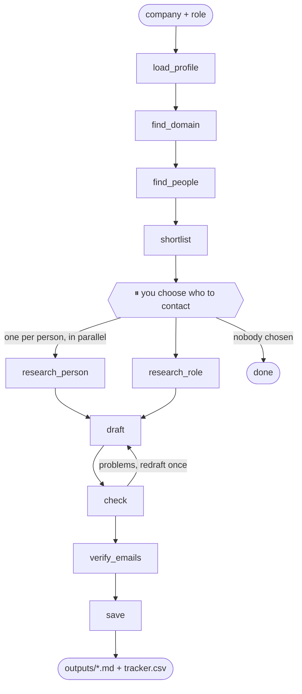

# Outreach Agent

An AI agent that prepares **personalized cold outreach** for a job you want.

Give it a company and a role. It finds recruiters and engineering managers, lets you choose who to contact, researches each person and the role, and drafts a LinkedIn note and an email for each one, grounded in your resume.

**It never sends anything.** You review, edit and send every message yourself.

```
$ python agent.py --company "Acme" --role "Backend Engineer"
  [load_profile] Your Name: 6 highlights
  [find_domain] Acme -> acme.com
  [find_people] 24 people at acme.com
  [shortlist] 5 suggested

Suggested people at acme.com:
  1. Jane Doe, Technical Recruiter [recruiter]
  2. Bob Roe, Engineering Manager, ML Platform [engineering manager]
  ...
Who should I research and draft for? (e.g. 1,3,4 / all / none): 1,2

  [research_person] Jane Doe: 0 hook(s)
  [research_person] Bob Roe: 2 hook(s)
  [research_role] 4 talking point(s)
  [draft] 2 draft(s) written
  [check] 1 draft(s) need fixes
  [draft] 1 draft(s) written
  [check] 0 draft(s) need fixes
  [verify_emails] 2/2 valid
  [save] outputs/2026-10-22_acme_backend-engineer.md and outputs/tracker.csv
```

## How it works

Two MCP servers do the outside work; a LangGraph agent decides the steps.

| Part | What it is | Talks to |
|---|---|---|
| `servers/people_server.py` | MCP server: `find_people`, `find_email`, `verify_email`, `hunter_credits` | [Hunter.io](https://hunter.io) |
| `servers/research_server.py` | MCP server: `web_search`, `read_page` | [Tavily](https://tavily.com) |
| `agent.py` | LangGraph agent: the graph below | both servers + OpenAI |



| Node | Uses | Job |
|---|---|---|
| `load_profile` | model (cached) | Turn your resume into a structured profile: skills, highlights, exact metrics |
| `find_domain` | web search + code | Company name → website domain (skip with `--domain`) |
| `find_people` | Hunter | People in HR, IT, management and research departments, with title, LinkedIn and email |
| `shortlist` | model | Label each person recruiter / engineering manager / skip; keep the best few |
| `review` | **you** | The graph pauses (`interrupt`) until you pick who to contact |
| `research_person` | Tavily + model | Up to 3 professional "hooks" per person, each with a source link. Runs in parallel (`Send`) |
| `research_role` | Tavily + model | What the role and team are about, from the job posting and company blog |
| `draft` | model | A LinkedIn note (≤300 characters) and an email (≤160 words) per person |
| `check` | code + model | Length and placeholder checks; fact-check every claim against your resume and the research |
| `verify_emails` | Hunter | Check addresses before you send |
| `save` | code | Write the drafts to `outputs/` and log everyone in `outputs/tracker.csv` |

### Guardrails
- **Nothing is sent automatically.** LinkedIn bans automation, and bulk email hurts your reputation.
- **No LinkedIn scraping.** People come from Hunter; research comes from the public web, with linkedin.com excluded. LinkedIn URLs are listed so you can open profiles yourself.
- **No invented facts.** Hooks must cite a URL that was actually in the search results; the checker flags any claim not backed by your resume or the research.
- **Professional information only** about the people you contact.
- **Small numbers on purpose:** at most `MAX_PEOPLE` (default 6) per company.
- **Credit-friendly:** Hunter and Tavily results are cached for 7 days in `outputs/.cache/`.

## Setup

### 1. Get API keys
- **OpenAI:** https://platform.openai.com/api-keys (needs API credits; separate from ChatGPT Plus)
- **Hunter.io:** sign up at https://hunter.io → *API* in the dashboard
- **Tavily:** sign up at https://app.tavily.com (key starts with `tvly-`)

### 2. Install
```bash
cd outreach-agent
python3 -m venv .venv
source .venv/bin/activate
pip install -r requirements.txt
```

### 3. Configure
```bash
cp .env.example .env        # then fill in the three keys
```
Put your resume in `profile/` (PDF or Markdown) and point `RESUME_PATH` in `.env` at it.

**Optional: `profile/notes.md`.** Anything you write here is added to the drafting instructions, for example:
```
- Don't cite the Incident Pilot metrics.
- I'm looking for new-grad roles starting January 2027.
- Keep the tone friendly but not casual.
```

`profile/`, `outputs/` and `.env` are in `.gitignore`: your resume, the research about people, and your keys never go to GitHub.

## Run
```bash
python agent.py --company "Stripe" --role "Backend Engineer"
python agent.py --company "Stripe" --role "Backend Engineer" --domain stripe.com --job-url https://stripe.com/jobs/...
python agent.py --graph      # print the graph as Mermaid (paste into https://mermaid.live)
```
`--job-url` is optional but makes the messages noticeably more specific.

Then open the Markdown file in `outputs/`, **edit each message**, and send it yourself. Update the `status` column in `outputs/tracker.csv` as replies come in.

### Rough cost per company (6 people)
- Hunter: ~3 credits for the search (0 if cached) + 0.5 per email verified
- Tavily: ~14 basic searches
- OpenAI: ~20 small `gpt-4o-mini` calls (a few cents)

Free plans are limited, so check your balances (`hunter_credits` in the MCP Inspector, or the Hunter and Tavily dashboards).

## Test the servers on their own (optional)
```bash
npx @modelcontextprotocol/inspector .venv/bin/python servers/people_server.py
npx @modelcontextprotocol/inspector .venv/bin/python servers/research_server.py
```

## Files

| File | Purpose |
|---|---|
| `agent.py` | The LangGraph agent |
| `servers/people_server.py` | Hunter.io MCP server |
| `servers/research_server.py` | Tavily MCP server |
| `requirements.txt` | MCP SDK v2, LangGraph, OpenAI, httpx, python-dotenv, pypdf |
| `.env.example` | Template for keys and settings |
| `profile/` | Your resume and optional `notes.md` (not committed) |
| `outputs/` | Drafts, `tracker.csv`, caches (not committed) |

## Troubleshooting

| Problem | Fix |
|---|---|
| `Hunter: HUNTER_API_KEY is not set` | Add the key to `.env`. |
| `Hunter API error 401` / `Tavily API error 401` | The key is wrong or expired; copy it again from the dashboard. |
| `Hunter API error 429` or "usage limit" | You're out of Hunter credits for the month. Cached companies still work. |
| `0 people at company.com` / very few suggestions | Hunter has little data on that company (common for startups). Try `--domain` with the exact domain, or a larger company. |
| `Couldn't work out X's website` | Pass `--domain company.com`. |
| `RateLimitError ... insufficient_quota` | Your OpenAI account needs credits. |
| A person has "0 hooks" | Nothing reliable was found about them; the message is based on the role and team instead. That's intended: better than guessing. |
| ⚠️ "The checker still flagged" in the output | Read that draft carefully and fix the flagged point before sending. |

## Ideas for next steps
- Follow-ups: a scheduled check that drafts a polite follow-up after 5–7 days with no reply.
- Read replies from Gmail and update `tracker.csv` automatically.
- A SQLite checkpointer so a paused review survives closing the terminal.
- Apollo.io as a second people source for companies Hunter knows little about.
