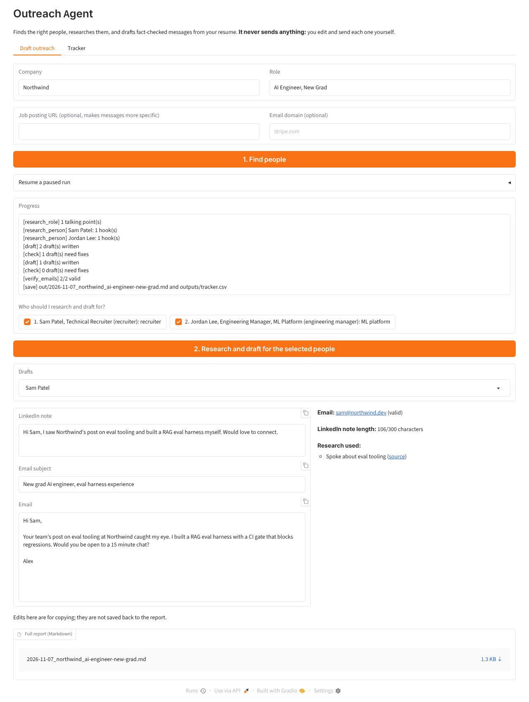
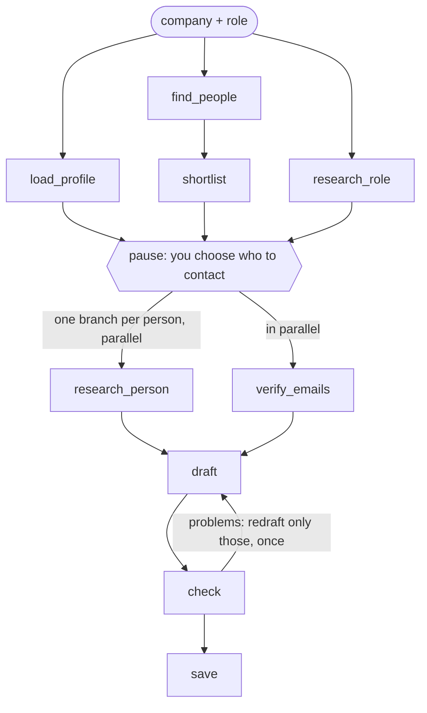

# Outreach Agent

A LangGraph agent that prepares personalized, fact-checked outreach for a job: it finds
recruiters and engineering managers, pauses for you to choose who to contact, researches
each person and the role in parallel, drafts a LinkedIn note and an email grounded in your
resume, and checks every claim before you see it.

**It never sends anything.** You review, edit and send every message yourself.

```
$ python -m outreach_agent --company "Northwind" --role "AI Engineer" --job-url https://...
  [find_people] 14 people via company name 'Northwind'
  [shortlist] 4 suggested
Suggested people at northwind.dev:
  1. Sam Patel, Technical Recruiter [recruiter] ...
  2. Jordan Lee, Engineering Manager, ML Platform [engineering manager] ...
Who should I research and draft for? 1,2
  [research_person] Jordan Lee: 2 hook(s)
  [draft] 2 draft(s) written
  [check] 1 draft(s) need fixes
  [draft] 1 draft(s) written
  [check] 0 draft(s) need fixes
  [save] outputs/2026-11-07_northwind_ai-engineer.md and outputs/tracker.csv
```

## Web UI

```bash
pip install -e ".[ui]"
python -m outreach_agent.ui        # http://127.0.0.1:7860
```

Find people, tick who to contact, then review each draft with the research and sources it used,
copy buttons, and a live LinkedIn character count. **Every message is editable:** your changes stay when you switch between people, "Undo my edits" restores the agent's draft, and "Save my edits" writes them to the report, marked as edited. **Open in Gmail** opens a filled-in compose window in
a new tab (recipient, subject and your edited text); you press Send. It stays locked for a draft the
checker still flags until you edit it. Set `GMAIL_ACCOUNT` if you're signed in to several Google accounts. Runs are checkpointed, so a paused review can be
picked up later from the UI or the command line. The screenshot uses the test fakes (fictional people).



## Architecture



Everything that doesn't depend on who you pick runs in parallel before the review, so the wait after
you approve is only the per-person work.

| Component | Role |
|---|---|
| `servers/people_server.py` | MCP server over Hunter.io: people, emails, verification. Results cached 7 days |
| `servers/research_server.py` | MCP server over Tavily: web search and page reading. LinkedIn and personal social media (Instagram, Facebook, TikTok, Threads, Pinterest, Snapchat) are never searched or read |
| `outreach_agent/graph.py` | The graph. Depends only on small `StructuredLLM` and `Tools` interfaces, so it runs against fakes in tests |
| `outreach_agent/checks.py` | Free deterministic checks: length limits, placeholders, stock phrases, wrong recipient or company |
| `outreach_agent/runtime.py` | Opens both MCP servers (with retry policies), the model client and the SQLite checkpointer for a run |
| `outreach_agent/metrics.py` | Times every step and counts model calls and tokens, including cached input |
| `outreach_agent/cli.py`, `ui.py` | Command line and Gradio front ends over the same graph |

## Design decisions

- **Human approval before any research or drafting.** The graph pauses with `interrupt()`, and the
  state is checkpointed in SQLite, so a paused review survives closing the terminal
  (`--resume <run id>`).
- **Grounding is enforced in code, not just asked for in the prompt.** A hook about a person is kept
  only if the model is confident the results are about that person, its source URL was actually
  retrieved, and the named artifact (talk, post, repository) appears in that result's title or snippet.
- **Two layer checking.** Deterministic rules run first (free), then a model review compares every
  claim with the resume, the research and the role brief. Only failing drafts are redrafted, once.
- **Graceful degradation.** If Hunter can't resolve the company name, ranked fallback domains are tried;
  quota and auth errors stop the run immediately with a clear message.
- **Small numbers on purpose:** at most `MAX_PEOPLE` (default 6) contacts per company.
- **Overlap independent work.** Profile parsing, the people lookup and role research start together;
  the two Hunter searches run concurrently; the domain search only runs if the company name lookup
  finds nobody; email verification runs alongside per-person research.
- **Prompt layout for caching.** Draft and check prompts put the context shared by every contact
  (instructions, your profile, the role brief) first and the person-specific part last, so OpenAI's
  prompt cache can serve the repeated prefix. The run stats show how much input came from the cache.
- **Retries where they help.** Tool calls retry timeouts and 5xx errors with exponential backoff and
  jitter (and Tavily's 429 rate limit); Hunter's 429 means the quota is gone and fails fast. The OpenAI
  SDK handles its own retries.
- **Every run is measured.** Each step records its time, model calls and tokens; the report ends with
  a run stats table, and the UI shows the wait after approval, call count, cache share and (if you set
  prices in `.env`) estimated cost.

## Evaluation

The checker is the part that protects you from sending something false, so it has its own eval
(`evals/`): six accurate drafts plus one copy of each with a single seeded error (fabricated metric,
skill or experience, pretended familiarity, invented fact about the recipient, wrong company).
It measures recall on seeded errors and the false positive rate on accurate drafts.

```bash
python -m evals.run_checker_eval --rules-only     # free: deterministic checks alone
python -m evals.run_checker_eval --repeats 3      # with the model; also measures verdict stability
```

| Checker | Recall on seeded errors | False positives |
|---|---|---|
| Rules only | 17% (catches wrong company only) | 0% |
| Rules + model | _run `--repeats 3` and record here_ | |

## Setup

```bash
python -m venv .venv && source .venv/bin/activate
pip install -e ".[dev]"
python -m pytest -q                      # 66 offline tests: fake model and MCP servers, no keys
cp .env.example .env                     # OpenAI, Hunter.io and Tavily keys
```

Put your resume in `profile/` (PDF or Markdown) and set `RESUME_PATH`. Optional `profile/notes.md`
adds instructions to every draft (tone, things not to mention). `profile/`, `outputs/` and `.env`
are git-ignored.

```bash
python -m outreach_agent --company "Stripe" --role "Backend Engineer" --job-url https://...
python -m outreach_agent --resume <run id>   # continue a paused review
python -m outreach_agent --graph             # print the graph as Mermaid
```

**Cost per company (6 people):** about 3 Hunter credits (0 if cached) plus 0.5 per email verified,
about 14 Tavily searches, and about 20 small model calls (a few cents).

## Next

- Record reply rates in `tracker.csv` and report them per message style.
- Draft follow-ups after 5 to 7 days with no reply.
- A second people source for companies Hunter knows little about.
